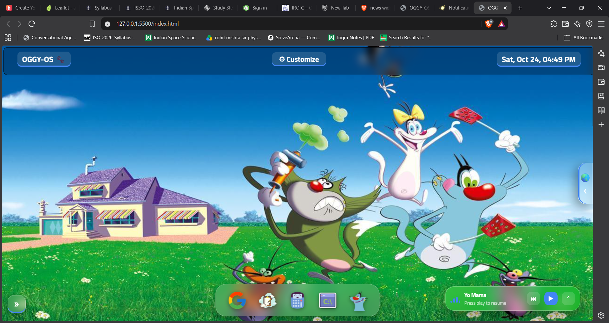

# OGGY-OS 🐾

A web-based desktop OS themed around *Oggy and the Cockroaches*, built with plain HTML, CSS and vanilla JavaScript. No login, no password: open the link and try it.

**Live demo:** https://kumarishan0825.github.io/OGGY-OS/

---

# Overview

---

## Features
**Desktop**
- Multiple draggable windows : Google, Notes, Calculator, Command Prompt and an Oggy game
- Dock with a magnify-on-hover effect, floating app labels, and dots that show which apps are open
- Smooth window pop-in animation
- Live clock in the header with 12h/24h format and an optional seconds display

**Customize widget** 
- Wallpapers: Oggy photo, plus animated Night, Sunny and Aurora gradients
- Upload your own wallpaper
- Accent colour and glass blur sliders, applied to the whole OS through CSS variables
- Turn the wallpaper animation on or off, and reset everything to default
- All choices are saved in your browser

**News panel** 

- Open it with the >> button or by swiping right from the left edge
- Headlines for your region (India, US, UK, Australia, Canada), chosen automatically and changeable
- **Markets tab** with live crypto prices in your local currency
- Glassmorphic design, loading skeletons and cached results

**Earth panel**
- Satellite map with live **latitude and longitude** shown as you move or click
- Search a place or type coordinates, use your current location, and switch between satellite and street views
- Copy coordinates, or open the same spot in **Google Earth** or Google Maps

**Apps**
- Notes with PDF export
- Calculator
- Command Prompt with built-in commands
---

## Tech

Structure :- HTML5 
Styling :- CSS3: variables, flexbox, grid, backdrop-filter(glass effect), transitions, keyframe animations, clamp()
Logic :- Vanilla JavaScript: DOM events, pointer events (drag and swipe), fetch, FileReader, localStorage 
Map :- [Leaflet](https://leafletjs.com/) 
Data :- GDELT and Google News RSS (news), CoinGecko (crypto), Nominatim (place search) 

No frameworks, no build step, and no API keys. Everything runs in the browser.
---

## Credits
Icons by [Icons8](https://icons8.com). Oggy and the Cockroaches © Xilam Animation (fan project, no affiliation). Fonts by [Google Fonts](https://fonts.google.com/). Website features by [w3schools](https://www.w3schools.com/howto/howto_js_draggable.asp), Dock design learned and inspired by [CodeGrid](https://www.youtube.com/watch?v=_Y1REGc1O5U), Oggy Games I took By [Oggy Moshi](https://cartoongames.io/game/oggy-moshi).Untouched by AI, Pure coding and watching tutorials and learning about These things with a book I bought called "Mastering HTML,CSS, and JS "by Lenmay,Colbum,Kymin
**Data and services (free, no API keys)**
News: [GDELT Project](https://www.gdeltproject.org/) and Google News RSS (via [rss2json](https://rss2json.com/))
Crypto prices: [CoinGecko](https://www.coingecko.com/)
Map library: [Leaflet](https://leafletjs.com/)
Satellite imagery: Tiles © Esri, Maxar, Earthstar Geographics
Street map: © [OpenStreetMap](https://www.openstreetmap.org/copyright) contributors
Place search: [Nominatim](https://nominatim.org/)
Open in Google Earth" and "Maps" buttons link to Google Earth and Google Maps (opened in a new tab; not embedded)

---

## Privacy
Customize settings, uploaded wallpapers, region and the last map pin are saved only in your own browser (localStorage). Nothing is uploaded to a server.

